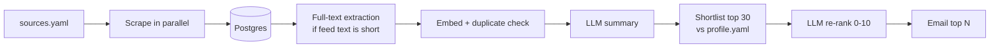

# AI News Aggregator

A daily AI news digest. It collects articles from AI blogs and communities, removes duplicates,
summarizes each story with an LLM, ranks them against your interests, and emails you the top 10.

## Features

- Parallel RSS and YouTube ingestion; one broken feed never stops a run
- Duplicate detection by URL and by meaning (embeddings), including the same story from two sources
- Structured LLM summaries with automatic retries and request rate limiting
- Two-stage ranking against your interests: embedding shortlist, then LLM re-rank with a lighter-model fallback
- HTML and plain-text email, sent daily by GitHub Actions
- Sources and interests are plain YAML files; no code changes needed

## Tech stack

| Part | Choice |
|---|---|
| Language | Python 3.12+, managed with uv |
| Database | PostgreSQL + pgvector on Neon |
| Data layer | SQLAlchemy, Alembic migrations |
| LLM | Gemini (OpenAI optional) through the OpenAI SDK |
| Email | Gmail SMTP |
| Scheduling | GitHub Actions |

## How it works



1. **Ingest:** feeds are fetched, URLs normalized, and new articles inserted (`ON CONFLICT DO NOTHING`).
2. **Enrich:** short snippets are replaced by the full article text; each article is embedded and
   marked as a duplicate if it is at least 0.88 similar to one from the last 7 days.
3. **Summarize:** a 2-3 sentence summary per article. Failures retry on later runs (3 attempts;
   rate-limit errors don't count).
4. **Rank:** `config/profile.yaml` is embedded to shortlist the 30 closest unsent articles from the
   last 48 hours, then the LLM scores only those.
5. **Deliver:** the top N are emailed and marked as sent, so the next digest has only new items.

Each run is recorded in the `pipeline_runs` table with counts and token usage.

## Setup

You need Python 3.12+, [uv](https://docs.astral.sh/uv/), a [Neon](https://neon.tech) database
and a Gemini key from [aistudio.google.com/apikey](https://aistudio.google.com/apikey).

```powershell
Copy-Item .env.example .env         # macOS/Linux: cp .env.example .env
# fill in .env (see Configuration), then:
uv sync
uv run python -m app.main migrate
uv run python -m app.main check-llm
uv run python -m app.main run --dry-run    # prints the digest, writes digest_preview.html
uv run python -m app.main run              # sends the real email
```

No uv? Run `python -m venv .venv`, activate it, `pip install -e .`, and drop the `uv run` prefix.

| Command | Purpose |
|---|---|
| `migrate` | Create or update the database tables |
| `check-llm` | Test the provider, key and models |
| `check-sources` | Test every configured feed |
| `run --dry-run` | Run the pipeline and print the digest instead of emailing |
| `run` | Run the pipeline and email the digest |

## Configuration

Put these in `.env` locally, and in GitHub secrets for the scheduled run.

| Variable | Purpose |
|---|---|
| `DATABASE_URL` | Neon **direct** connection string (turn pooling off; the host has no `-pooler`) |
| `LLM_PROVIDER` | `gemini` or `openai` |
| `GEMINI_API_KEY` / `OPENAI_API_KEY` | Key for the chosen provider |
| `SMTP_USER` | Gmail address that sends the digest |
| `SMTP_PASSWORD` | Gmail **app password** (16 characters), not your normal password |
| `EMAIL_TO` | Where the digest is delivered (can be the same address) |

Create a Gmail app password at [myaccount.google.com/apppasswords](https://myaccount.google.com/apppasswords)
(2-Step Verification must be on).

Optional: `TOP_N` (10), `LOOKBACK_HOURS` (48), `REQUESTS_PER_MINUTE` and `WORKERS` (lower them if
Gemini returns 429 errors), `SUMMARY_MODEL`, `RERANK_MODEL`, `EMBEDDING_MODEL`. See `.env.example`.

To change what you receive, edit `config/sources.yaml` (feeds) and `config/profile.yaml` (interests).

## Tests

Database tests need a separate throwaway database. They wipe the schema they connect to, so they
only use `TEST_DATABASE_URL` and refuse to run unless its database name contains "test".

1. In Neon, create a second database named `ai_news_test`.
2. Add its direct connection string to `.env` as `TEST_DATABASE_URL`.
3. Run `uv run pytest`.

No real LLM is called during tests. To skip the database tests:
`uv run pytest --ignore=tests/test_pipeline_db.py`.

## Deploy with GitHub Actions

`.github/workflows/daily.yml` runs every day at 02:30 UTC (08:00 IST).

1. Push the project to a private GitHub repository. Never commit `.env`.
2. Go to Settings > Secrets and variables > Actions and add `DATABASE_URL`, `GEMINI_API_KEY`,
   `SMTP_USER`, `SMTP_PASSWORD` and `EMAIL_TO`.
3. Open the Actions tab, choose "Daily AI news digest" > Run workflow, and tick **dry run** first.

GitHub cron uses UTC and can start 10-60 minutes late. In a public repository, scheduled workflows
pause after 60 days without repository activity.

## Project structure

```
app/          main.py (CLI), pipeline.py, scrapers/, enrich.py, rank.py, llm.py,
              digest.py, models.py, config.py, db.py
config/       sources.yaml, profile.yaml
migrations/   Alembic migrations
tests/        unit and integration tests
.github/workflows/daily.yml
```

## Limitations

- Gemini's API has daily request limits per model; if the main re-rank model is unavailable, a
  lighter model is used instead.
- Sites that block scripted downloads (such as openai.com) are summarized from the feed text.
- The Anthropic feeds come from a community-maintained mirror, not an official feed.

## Acknowledgements

Inspired by [datalumina/ai-news-aggregator](https://github.com/datalumina/ai-news-aggregator).